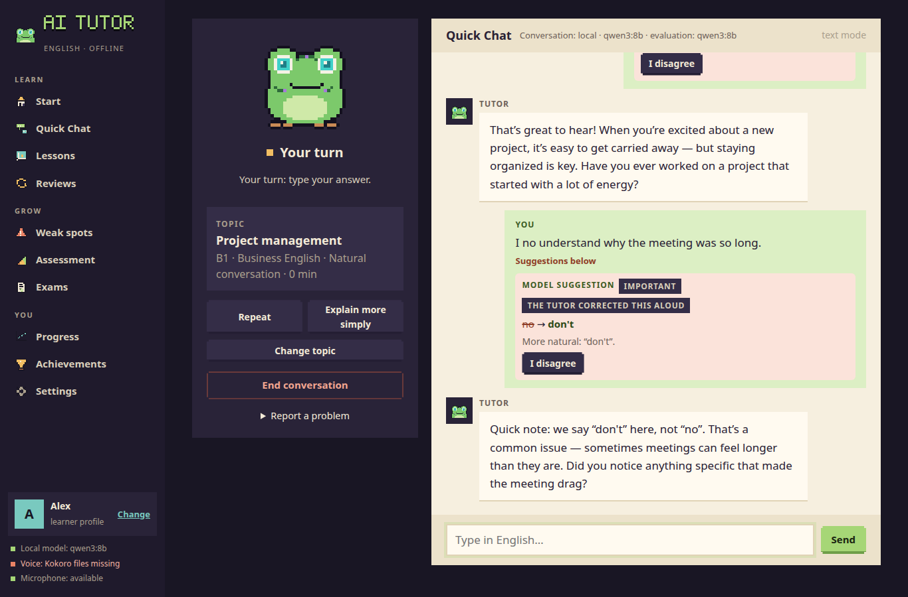
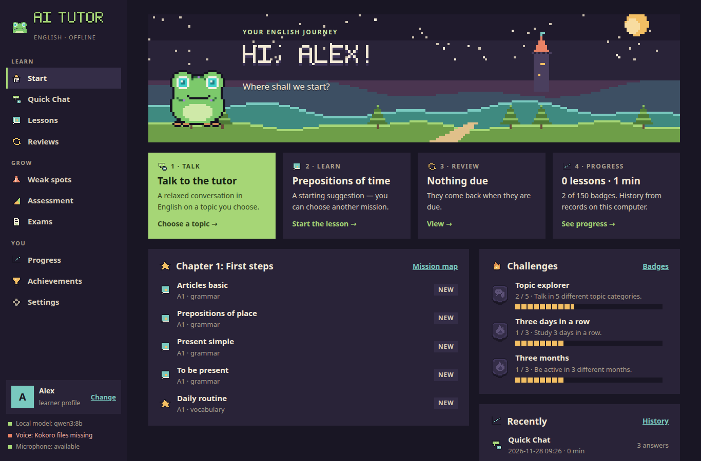
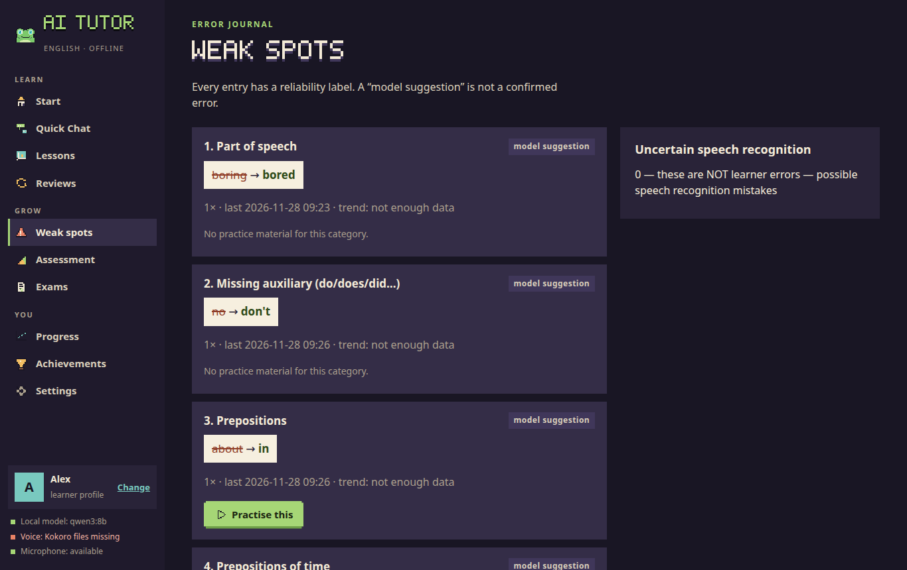
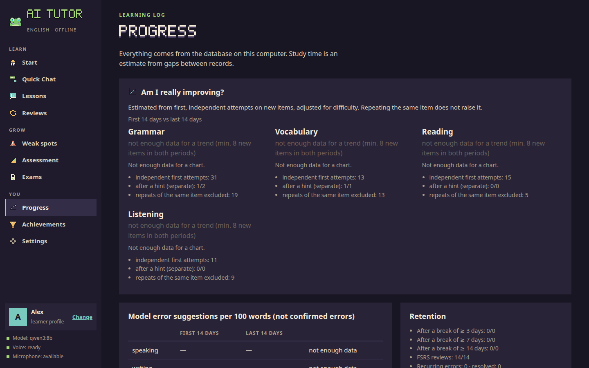
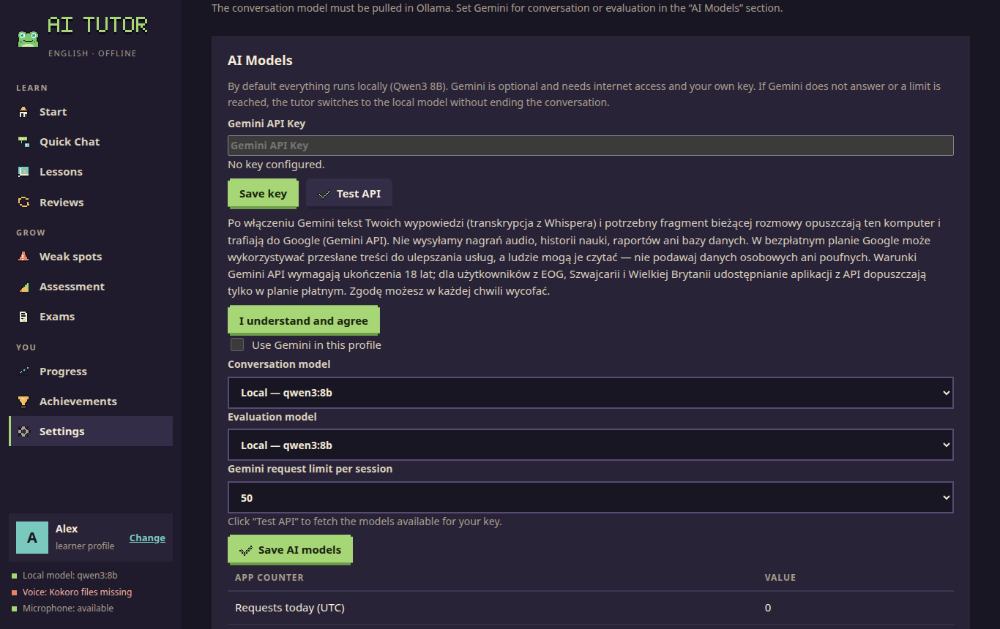
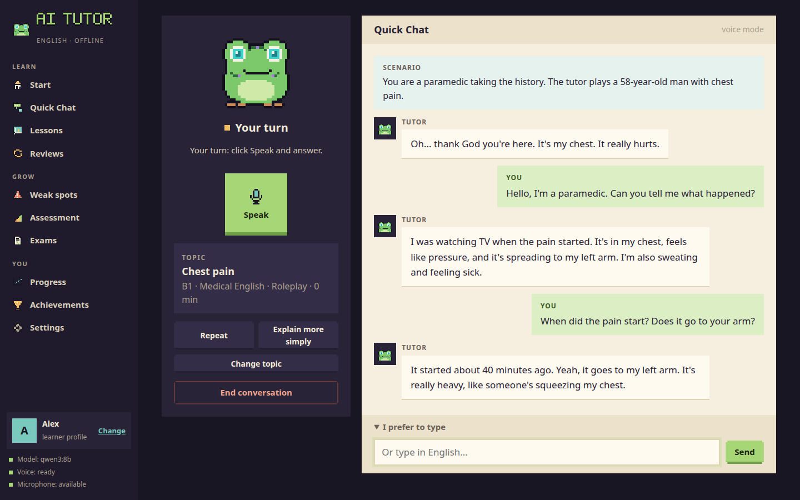
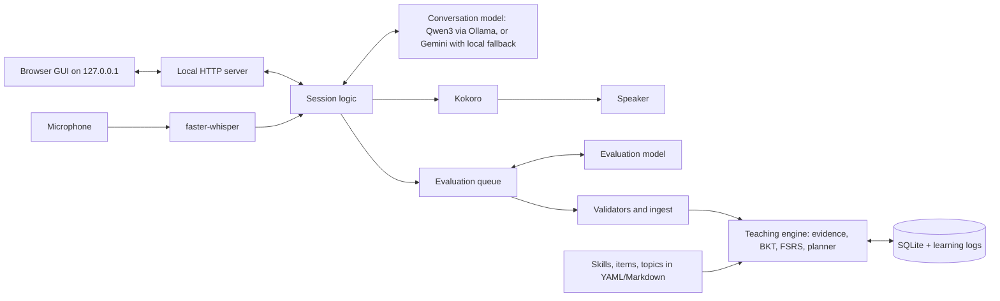

# AI Language Tutor

A voice-first English tutor for adult learners (Polish speakers) that runs on your own computer. A language model
holds the conversation and suggests corrections; a deterministic teaching engine decides what counts as evidence,
what you practise next and when you review it.

By default everything is local: **Qwen3 8B** through [Ollama](https://ollama.com), speech recognition
(faster-whisper) and speech synthesis (Kokoro) on the CPU, learner data in a local SQLite file. No account and no API
key are needed. Google Gemini can optionally be used per profile, with automatic fallback to the local model.



> **Status: research prototype, version 0.1.** The browser interface and the command line share one engine and are
> covered by automated tests. Corrections are **model suggestions** and can be wrong. Levels are provisional
> estimates, **not CEFR certificates**. The voice path has been tested with simulated audio and by the author, but
> not systematically on other microphones. The project has **no licence yet** (see [Licence](#licence)).

## Contents

- [Key features](#key-features)
- [Screenshots](#screenshots)
- [Installation (Ubuntu / Linux)](#installation-ubuntu--linux)
- [Usage](#usage)
- [How corrections work](#how-corrections-work)
- [Optional Gemini API](#optional-gemini-api)
- [Learning logs](#learning-logs)
- [Configuration](#configuration)
- [Testing](#testing)
- [Architecture](#architecture)
- [Limitations](#limitations)
- [Documentation](#documentation)
- [Contributing](#contributing)
- [Licence](#licence)

## Key features

| Area | What it does |
|---|---|
| **AI voice conversation** | Speak (push-to-talk) or type. Whisper transcribes and flags uncertain words; the tutor answers in short spoken replies through Kokoro. Interrupt the tutor with Enter / the Speak button. |
| **Quick Chat** | Free conversation at an automatic or chosen level (A1–C1), in five categories (General, Technical/IT, Medical, Business, Professional situations) or on your own topic, in three modes (natural, guided, role-play). 40 topics and 25 role-play scenarios. A new chat starts with a short greeting and one question; spoken commands such as “change the topic”, “repeat”, “explain more simply” and “I want to finish” are recognised. |
| **Grammar feedback during the conversation** | Each of your utterances is evaluated in the background. Under your message you see “Checking…”, then the model's suggestions with a short explanation and a weight (important / grammar / minor). Serious, meaning-changing mistakes get one short spoken correction at the start of the tutor's reply; ordinary grammar mistakes get an occasional gentle recast; minor slips are only shown. Every suggestion can be disputed. |
| **Correction modes** | At the end (no interruptions), now and then (default) and as we go (step-by-step hints). |
| **Error tracking** | A weak-spots journal built from stored observations, with a reliability label on every entry (model suggestion, confirmed by exercises, uncertain transcription), trends only when there is enough data, and **Practise this** where matching exercises exist. Spelling is never judged from speech. |
| **Adaptive lessons** | Short missions: explanation, closed exercises with hints, then a short conversation using the target form. A deterministic planner picks the next lesson from due reviews, recurring mistakes and skills in progress. Recurring mistakes get a staged cycle: check before the explanation, practice, an independent test on other tasks, and a transfer check days later. 20 skills currently have complete lesson material. |
| **Spaced repetition** | FSRS scheduling; reviews use unseen items first, then the least recently used. |
| **Assessment and progress** | Optional quick placement and a six-skill assessment with an uncertainty range. Progress uses first, independent attempts on new items, retention after 3, 7 and 14 days, and says “not enough data” instead of inventing a trend. |
| **Learning logs** | Local record of sessions, model calls, evaluation timing, correction decisions and learner reports, with a Markdown report and a redacted export. |
| **Optional Gemini** | Per-profile key, consent and model choice for conversation and/or evaluation; automatic fallback to local Qwen3; the app works fully without it. |
| **Interface** | Local browser GUI in Polish or English (pixel-art design, frog mascot), plus a Polish command line. Several local profiles with export, progress reset and deletion. Also: 150 achievements (kept separate from skill mastery) and one exam-practice path (Polish 8th-grade exam). |

## Screenshots

All images come from the running application (`python main.py --gui`, English interface) with an isolated
demonstration profile and the local Qwen3 8B model. No real learner data and no API key are shown.

| | |
|---|---|
|  **Home:** next steps — talk, learn, review, progress. |  **Quick Chat setup:** level, category, mode, time and correction mode. |
|  **During the conversation:** a model suggestion under the learner's message, marked “corrected aloud” when the tutor said it. |  **Weak spots:** reliability labels and practice where material exists. |
|  **Lessons:** mission map by level. |  **Progress:** first-attempt estimates; “not enough data” instead of an invented trend. |
|  **Settings → AI Models:** local by default; optional Gemini key, consent and model choice. |  **Role-play:** the tutor stays in character (Medical English). |

Lessons, progress, role-play, assessment (`06-assessment.png`) and achievements (`08-achievements.png`) were captured
at milestone F7 (November 2026); the other images are from the current version.

## Installation (Ubuntu / Linux)

**Tested on:** Ubuntu 24.04, Python 3.12 (also installs on 3.13), Ollama 0.9.0, Ryzen 7 3700X, 31 GiB RAM,
RTX 2060 SUPER 8 GiB. Other Linux distributions should work; macOS and Windows are untested. Text mode needs no
microphone or speakers.

```bash
# 1. System packages (libportaudio2 only for voice)
sudo apt install python3-venv git libportaudio2

# 2. Code and virtual environment
git clone https://github.com/krauzerl/english-ai-tutor.git
cd english-ai-tutor
python3 -m venv .venv
source .venv/bin/activate
pip install -e .                 # core: text mode and the GUI
pip install -e ".[voice]"        # faster-whisper, Kokoro, sounddevice

# 3. Ollama and the model (install Ollama from https://ollama.com first)
ollama pull qwen3:8b
ollama list                      # the Ollama server must be running (system service or `ollama serve`)

# 4. Kokoro voice files (only for voice)
mkdir -p ~/.local/share/english-ai-tutor/models/kokoro
cd ~/.local/share/english-ai-tutor/models/kokoro
curl -LO https://github.com/thewh1teagle/kokoro-onnx/releases/download/model-files-v1.0/kokoro-v1.0.int8.onnx
curl -LO https://github.com/thewh1teagle/kokoro-onnx/releases/download/model-files-v1.0/voices-v1.0.bin
cd -

# 5. First profile and start
python main.py profile create alice
python main.py --gui             # opens http://127.0.0.1:8765/
```

The Whisper model (`small.en`) is downloaded by faster-whisper the first time speech recognition starts. Check audio
devices with `python main.py --voice --list-devices`; `docs/TESTING.md` has read-only Ubuntu audio checks.

Optional extras: `".[gemini]"` (Gemini and the system keyring), `".[dev]"` (tests and Ruff), `".[browser-tests]"`
(Playwright GUI tests), `".[piper]"` (Piper voice, GPL-3.0). `pyproject.toml` is the single source of dependencies.

**Measured on the machine above:** Qwen3 8B (Q4_K_M, thinking off) uses about 6 GiB of VRAM; evaluating one
utterance takes a median of 1.8 s; with live corrections on, the tutor starts replying about 2–3.5 s after a typed
message. CPU-only inference and GPUs with less than 8 GiB were not measured.

## Usage

### Browser interface

```bash
python main.py --gui                          # http://127.0.0.1:8765/
python main.py --gui --port 8800 --no-browser
```

The server listens only on `127.0.0.1`. In voice mode press **Speak** to record and again to stop; the microphone and
speakers are used by the Python process, not by the browser. **I prefer to type** or the text-mode switch lets you
type instead. `Ctrl+C` in the terminal stops the server; unfinished lessons, reviews and conversations resume.

### Command line

Run from the repository root with the virtual environment active. Add `--no-audio` for text only. Command-line
messages are in Polish.

```bash
python main.py --voice --chat                                   # Quick Chat: choose a topic or type your own
python main.py --voice --chat --chat-level B1 --chat-category medical --chat-mode roleplay
python main.py --voice --lesson                                 # next lesson chosen from your data
python main.py --voice --placement                              # quick placement (grammar, vocabulary)
python main.py --voice --assess grammar,vocabulary,reading      # assessment of chosen skills
python main.py --voice --review                                 # spaced-repetition reviews
python main.py --voice --weakspots                              # weak-spots journal; --drill N practises entry N
python main.py --voice --progress                               # also --history, --achievements
python main.py --voice --finish-evals                           # finish evaluations left after earlier sessions

python main.py profile list                                     # also create, select, export, reset, delete
python main.py logs report                                      # learning report (Markdown), last 7 days
python main.py logs export                                      # redacted export for later analysis
python main.py content validate en                              # validate the content pack
```

`python main.py --help` lists the entry points. `python main.py` without options starts a minimal legacy text chat.

## How corrections work

1. Your utterance is stored first, then evaluated by the evaluation model (Qwen3 by default) through a queue — one
   utterance at a time, never at the same time as the tutor is generating a reply on the local GPU.
2. The model only quotes and labels mistakes. Code validates every observation (the quote must exist, accepted
   BrE/AmE variants and speech-recognition doubts are not errors, a correction must change something and must not
   change the meaning) before it is stored and shown.
3. In the “now and then” and “as we go” modes the tutor waits up to `eval_wait_s` (default 3 s) for that evaluation
   before replying, so a serious mistake can be corrected in the very next reply. If the evaluation is late, the
   reply is not delayed further: the suggestion appears in the window when ready and is not spoken out of context.
4. Corrections are always labelled as model suggestions. They never change skill mastery; only independent exercise
   results feed the teaching engine.

## Optional Gemini API

The tutor runs fully locally by default and needs no key. Gemini is an optional add-on.

1. Get an API key in [Google AI Studio](https://aistudio.google.com/). Install the extra: `pip install -e ".[gemini]"`.
2. In the GUI open **Settings → AI Models**, paste the key into **Gemini API Key** and click **Save key**.
3. Click **Test API**: the app lists the models your key can use for text generation and sends one fixed test prompt
   (“Reply with the single word OK.”) to the selected model. No learner data is sent by the test.
4. Read the privacy notice and click **I understand and agree**.
5. Tick **Use Gemini in this profile**, choose the **Conversation model** and the **Evaluation model** independently
   (Local Qwen3 or a model from the list), set the per-session request limit and click **Save AI models**.

Which Gemini models are available depends on your account; the app shows only what the API reports. Each profile
has its own key, consent and models; new profiles are local-only.

**Key storage.** The key is stored in the system secret store (Secret Service / GNOME Keyring via `keyring`) under a
random per-profile identifier. Without a secure store it is kept in memory for the current run only. It is never
written to SQLite, JSON or `config.toml`, never returned to the page and never logged. **Remove key** deletes it.

**Fallback.** On HTTP 429, timeouts, network or server errors, or a rejected model, the tutor switches once to local
Qwen3, shows one notice and continues with the same context; nothing is generated or stored twice. Short outages
pause Gemini for the time the API asks for (or two minutes); a daily quota, invalid key, unavailable model, missing
consent or the session request limit keep the session local until it ends. `/gemini` in a session retries. The
conversation header always shows which model actually answered and whether a fallback happened.

**Privacy and limits.** When Gemini is on, the current utterance and the recent part of the conversation (the same
context Qwen3 gets) are sent to Google. Audio, learning history, reports and the database are not sent. The app's
request and token counters are local and are not your Google quota or bill. Gemini is subject to Google's terms and
rate limits, which change over time; on the free tier Google may use submitted content to improve its products, so
do not send personal or confidential information. Check limits and any charges in Google AI Studio.

## Learning logs

The app records how learning sessions go, locally, so they can later be analysed (by you or, after you review the
export, by an AI model):

- **Stored automatically** in the local SQLite database: sessions, turns (transcripts; audio is never saved),
  evaluations and validator decisions, correction decisions (`log.correction`), evaluation timing (`log.eval_wait`,
  `log.eval_live`), tutor reply timing (`log.tutor_turn`), every model call with provider, model, latency and
  fallback (`log.llm`), speech-recognition events, errors and session ends.
- A text-free JSONL mirror per session in `~/.local/share/english-ai-tutor/learning-logs/` (identifiers, lengths and
  metadata only; files older than 180 days are pruned).
- **Reports:** Progress → *Learning report* in the GUI, or `python main.py logs report [--days N]`.
- **Export:** `python main.py logs export [--days N]` writes a redacted folder (`report.md`, `cases.jsonl`,
  `README.md`). Review it and remove anything private before sharing it.
- **Your reports:** “Report a problem” in a session and **I disagree** / **Misheard** on a correction are stored as
  learner reports.
- **Privacy setting:** Settings → *Learning log* turns detailed logging off for a profile (learner reports are still
  kept, because they are deliberate actions).

The logs describe what the app did; they do not prove that a correction was right. Model suggestions stay labelled
as unverified. Details: [docs/LEARNING_LOGS.md](docs/LEARNING_LOGS.md).

## Configuration

Optional file `~/.config/english-ai-tutor/config.toml` (outside the repository, mode 0600):

```toml
[llm.conversation]
provider = "ollama"
model = "qwen3:8b"
think = false            # omit for models without a thinking mode

[llm.evaluation]
provider = "ollama"
model = "qwen3:8b"

[llm.ollama]
url = "http://localhost:11434"

[conversation]
eval_wait_s = 3.0        # how long a reply may wait for the evaluation; 0 = never wait

[voice]
tts = "kokoro"
tts_voice = "bf_emma"
stt_model = "small.en"

[languagetool]
enabled = false          # experimental, off by default
```

Per-profile preferences (interface language, speech pace, voice, correction mode, text or voice mode, transcription
confirmation, audio devices, conversation model, Gemini) are changed in the GUI (**Settings**) or with
`python main.py --voice --set KEY=VALUE` (`--set ?` lists the keys). Data lives in
`~/.local/share/english-ai-tutor/` (`tutor.db`, learning logs, backups).

## Testing

```bash
pip install -e ".[dev]"
pytest                      # unit, integration, SQLite, migration and GUI tests with fake models
ruff check .
python main.py content validate en

pytest -m live              # needs a running Ollama with qwen3:8b; Gemini live tests skip without a key

pip install -e ".[browser-tests]" && playwright install chromium
pytest tests/test_browser.py              # GUI flows in headless Chromium with fake models

python -m bench.audit_control --repeat 3  # control set for false corrections (needs Ollama)
```

There is no CI service; tests are run locally, and the default `pytest` run needs no Ollama, network or audio
hardware. Live-model results vary between runs. Manual acceptance steps for the owner (including microphone checks)
are in [docs/TESTING.md](docs/TESTING.md).

## Architecture



| Path | Role |
|---|---|
| `tutor/voice/` | Session loop (`cli.py`), conversation turn pipeline, Whisper, Kokoro, audio I/O |
| `tutor/app/` | Sessions, evaluation queue and service, feedback policy, lessons, remediation, reviews, assessment, progress, learning logs |
| `tutor/pedagogy/` | Content model, evidence validation, error taxonomy, mastery (BKT), FSRS, planner — no LLM calls |
| `tutor/llm/` | Ollama and Gemini providers, routed fallback, structured output, key store |
| `tutor/gui/`, `tutor/services/` | Local HTTP server, static browser UI, API used by the GUI |
| `tutor/store/` | SQLite access and additive migrations (every learner table keyed by profile) |
| `tutor/content/` | Skills, exercise items, explanations, chat catalogue, exam paths |
| `bench/`, `tests/`, `tools/` | Benchmarks, pytest suite, content tools |

Design rules enforced by tests: the model observes, code decides (no number shown to a learner comes directly from
a model); conversation corrections never change mastery; repetition and hinted answers are not counted as
independent progress; audio is never stored.

## Limitations

- **Error detection is incomplete.** Qwen3 8B misses a sizeable share of mistakes (roughly a third on the control
  set) and sometimes proposes a wrong correction. Suggestions are labelled, can be disputed and never change mastery.
- **The tutor model does not always follow instructions** — it occasionally states a correction itself instead of
  a gentle recast, or mentions personal experiences it does not have.
- **Live corrections add latency:** in the correcting modes the reply starts about 2 s later than without them.
- **Pronunciation is not assessed.** Only the transcript is evaluated; a correct transcript does not mean correct
  pronunciation. Whisper `small.en` is weak on single words and proper names; uncertain words are never counted as
  your errors.
- **No CEFR certification.** Levels are provisional estimates from exercise material that no human has reviewed yet
  (237 items: 194 checked by an AI model, 43 drafts). Writing and speaking are collected as evidence without a level.
- **Experimental parts:** LanguageTool fusion (off), the exam path, some planner decisions; practice material exists
  for only part of the error categories, otherwise the journal says so.
- **Gemini** needs internet access and your own key, model availability depends on the account, and quotas can run
  out at any time (the app then continues locally).
- **Language:** English is the only learning language; explanations, the command line and some GUI texts (for
  example the Gemini consent notice and some lesson reasons) are in Polish.

## Documentation

- [docs/TESTING.md](docs/TESTING.md) — running the app, automated tests, owner test plans, microphone checks, measurements
- [docs/LEARNING_LOGS.md](docs/LEARNING_LOGS.md) — what is recorded, where, reports, export format, privacy
- [docs/DEVELOPMENT.md](docs/DEVELOPMENT.md) — current state, defaults and conventions for the next development session
- [docs/TROUBLESHOOTING.md](docs/TROUBLESHOOTING.md) — common problems
- [CHANGELOG.md](CHANGELOG.md) — changes by milestone
- [SECURITY.md](SECURITY.md) — reporting vulnerabilities
- [THIRD_PARTY_NOTICES.md](THIRD_PARTY_NOTICES.md) and [`tutor/content/en/ATTRIBUTION.md`](tutor/content/en/ATTRIBUTION.md) — sources and licences of teaching material

## Contributing

See [CONTRIBUTING.md](CONTRIBUTING.md) for setup, checks and content rules (teaching content carries a review
status; `human_reviewed` is set only by a person through `python main.py content review`).

## Licence

**No licence has been chosen yet.** Until the author decides, all rights are reserved and the code is not licensed
for reuse.

Teaching material adapted from third-party works under CC BY 4.0 and CC BY-SA 4.0 keeps its attribution and change
notices (see [THIRD_PARTY_NOTICES.md](THIRD_PARTY_NOTICES.md)). Models and dependencies are not redistributed and
keep their own licences; the optional Piper voice package is GPL-3.0.
