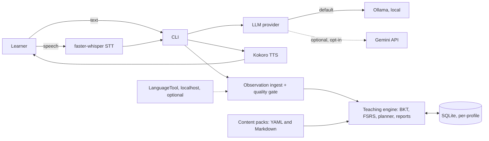

# English AI Tutor

**Free, private, local-first AI language tutor.**
Learn through natural conversation. No subscription required.


English AI Tutor is a command-line tutor for learners of English. A local language model
([Ollama](https://ollama.com)) holds the conversation; a deterministic, non-LLM engine decides
what to practise. Conversations, learner profiles and progress stay on your machine.

> **Status: early development (v0.1).** The building blocks below work and are tested, but they are
> not yet joined into one polished learning session. See [Current state](#current-state) and the [Roadmap](#roadmap).

## What makes it different

- **Local by default.** Text and voice run on your hardware. The only network calls go to your own Ollama server.
- **The LLM observes, code decides.** The model quotes mistakes and labels them. Scores, mastery, plans and
  reports are computed by plain, testable Python. No number shown to a learner comes straight from an LLM.
- **Honest about uncertainty.** Unverified observations from conversation are shown as suggestions. They do not
  lower mastery or force remedial lessons until a measured quality gate is passed.
- **Open, attributed teaching content.** Material is adapted from openly licensed textbooks, with source, licence and
  change notice tracked per source.
- **No recordings stored.** Voice mode keeps transcripts only.

## Current state

| Area | Status |
|---|---|
| Text chat with a local model (`python main.py`) | Working, minimal |
| Voice conversation: Whisper STT, Kokoro TTS (`python main.py --voice`) | Working prototype. Median time to first speech with Kokoro was above the 3 s target on the author's hardware |
| Learner profiles: create, list, select, export, delete | Working |
| LLM layer: Ollama, optional Gemini, structured output validation, cost limits | Working |
| Teaching engine: skills, items, diagnosis, BKT mastery, FSRS spaced repetition, planner, reports | Implemented and tested, **not yet wired into a user-facing session** |
| Content: 115 skills, pilot exercise bank, NGSL vocabulary (2,809 lemmas) | Pilot. **No item is human-reviewed yet**, so diagnosis and automatic mastery are switched off |
| Optional LanguageTool grammar checks (localhost only) | Working, off by default |
| Grammar-correction benchmark (`python -m bench.grammar`) | Working. Results are preliminary: the gold standard is not yet human-reviewed |
| Graphical interface | Not started |

## Architecture



Design rules: the teaching engine (`tutor/pedagogy/`) is pure and deterministic; every learner table is keyed by
`profile_id` with cascading delete; language content lives only under `tutor/content/<lang>/`; all LLM access
goes through one `LLMProvider` interface with schema-validated replies.

## Hardware requirements

Developed and measured on Ubuntu 24.04 with a Ryzen 7 3700X, 31 GiB RAM and an 8 GiB GPU.

| Setup | Needs |
|---|---|
| Tests, profiles, content tools | Any machine with Python 3.12+ |
| Conversation and evaluation with Qwen3 8B (default, Q4_K_M, thinking off) | About 6 GiB VRAM; fits fully on an 8 GiB GPU. Measured about 50 tokens/s |
| Polish texts with Bielik 11B v2.3 (default for `generation`, optional for the other roles) | About 7.2 GiB VRAM plus about 7 GB RAM with partial CPU offload. Measured about 30 tokens/s |
| Voice mode | Working microphone and speakers, PortAudio (`libportaudio2`). Whisper runs on CPU (int8) so the GPU stays free for the LLM |

## Installation (Ubuntu 24.04)

```bash
sudo apt install python3.12-venv git
git clone https://github.com/krauzerl/english-ai-tutor.git
cd english-ai-tutor
python3 -m venv .venv
source .venv/bin/activate
pip install -e .
```

Optional extras:

```bash
pip install -e ".[voice]"    # microphone, Whisper STT, Kokoro TTS
sudo apt install libportaudio2
pip install -e ".[piper]"    # alternative Piper TTS (GPL-3.0, see Licences)
pip install -e ".[gemini]"   # optional cloud provider
pip install -e ".[dev]"      # tests and linting
```

`pyproject.toml` is the single source of truth for dependencies; `requirements.txt` only points to it.

## Local models

Install Ollama (see [ollama.com](https://ollama.com)), start it, and pull the default models:

```bash
ollama pull qwen3:8b
ollama pull SpeakLeash/bielik-11b-v2.3-instruct:Q4_K_M
```

Defaults per role (no configuration needed):

| Role | Default model | Why |
|---|---|---|
| `conversation`, `evaluation` | `qwen3:8b`, `think = false` | Fewer false corrections and faster replies than Bielik 11B |
| `generation` (Polish texts) | `SpeakLeash/bielik-11b-v2.3-instruct:Q4_K_M` | Qwen3 writes Polish with errors |

The choice comes from a **preliminary** benchmark on one machine (130 cases, no human-reviewed gold standard yet).
It is not a confirmed result and may change after review. Thinking stays off: it raises latency, and Ollama
needs version 0.9.0 or newer for the `think` setting. Qwen3.5 was not tested (it needs a newer Ollama).

Configuration lives in `~/.config/english-ai-tutor/config.toml` (created on demand, outside the repository).
Every role can use Bielik instead. Leave `think` unset for Bielik, which has no thinking mode. Example:

```toml
[llm.conversation]
provider = "ollama"
model = "qwen3:8b"
think = false

[llm.evaluation]
provider = "ollama"
model = "SpeakLeash/bielik-11b-v2.3-instruct:Q4_K_M"   # optional: Bielik instead of Qwen3

[llm.generation]
provider = "ollama"
model = "SpeakLeash/bielik-11b-v2.3-instruct:Q4_K_M"

[llm.ollama]
url = "http://localhost:11434"
num_ctx = 8192

[voice]
tts = "kokoro"
tts_voice = "bf_emma"
stt_model = "small.en"

[languagetool]
enabled = false
url = "http://127.0.0.1:8081"   # localhost only; other hosts are rejected
```

Voice models are not bundled. Download the Kokoro files `kokoro-v1.0.int8.onnx` and `voices-v1.0.bin` from the
[kokoro-onnx releases](https://github.com/thewh1teagle/kokoro-onnx/releases) into
`~/.local/share/english-ai-tutor/models/kokoro/`. Whisper models are fetched by `faster-whisper` on first use.

## Usage

```bash
python main.py                      # minimal legacy text chat (fixed to Bielik 11B)
python main.py --voice              # voice conversation (needs the voice extra and models)
python main.py --voice --no-audio   # voice pipeline in text mode
python main.py profile create alice # also: list, select, export, delete
python main.py content validate en  # validate the content pack
python main.py content attribution en
python -m bench.grammar --system A  # grammar-correction benchmark
```

## Privacy

- Conversations, profiles and progress are stored in a local SQLite database under
  `~/.local/share/english-ai-tutor/`. Nothing is uploaded.
- Voice mode stores transcripts, never audio.
- External APIs (Gemini) are off by default, need your own key in `~/.config/english-ai-tutor/.env`,
  and need explicit consent per profile. Spending limits are enforced locally.
- LanguageTool, if enabled, must run on localhost; the adapter refuses other hosts and does not follow redirects.
- Profiles can be exported and deleted completely.

## Teaching engine

- **Skills and items:** a CEFR-tagged skill tree (A1 to C1) with exercises. Items carry a review status
  (`draft`, `ai_checked`, `human_reviewed`, `rejected`, `suspect`). Only a human, through `content review`, can mark an item reviewed.
- **Assessment:** the LLM returns structured observations (quote, category, confidence). Code scores them against rubrics
  and separates real errors from accepted variants, speech-recognition noise and disfluencies.
- **Mastery and memory:** Bayesian Knowledge Tracing with fixed parameters; spaced repetition via the `fsrs` library;
  retention checks at 7 and 30 days.
- **Planning and reports:** a deterministic planner picks the next practice; reports are built from recorded evidence.
- **Quality gate:** until measured on the benchmark and reviewed by a human, conversation observations stay suggestions.

## Roadmap

Nothing below is available yet.

- Human review of the exercise bank and of the grammar benchmark gold standard.
- A single guided learning session that joins conversation, planner and spaced repetition (next phase).
- Opening the quality gate after benchmark evidence.
- Graphical interface.
- Pronunciation feedback (explicitly out of the MVP).
- Further languages through additional `content/<lang>/` packs.

## Licences

**The project does not have a licence yet.** Until one is added, all rights are reserved by the author. The licence
for the original code is being decided.

Teaching material is adapted from third-party works and keeps its original licences (CC BY 4.0 and CC BY-SA 4.0),
with attribution and change notices. See [THIRD_PARTY_NOTICES.md](THIRD_PARTY_NOTICES.md) and
[`tutor/content/en/ATTRIBUTION.md`](tutor/content/en/ATTRIBUTION.md). Models and dependencies are not redistributed
and keep their own licences.

## Contributing

See [CONTRIBUTING.md](CONTRIBUTING.md). Report vulnerabilities as described in [SECURITY.md](SECURITY.md).
