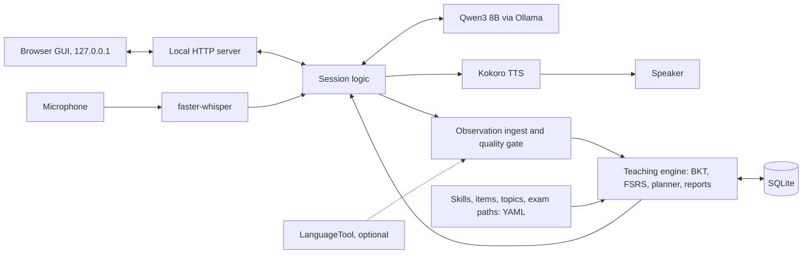

# AI Language Tutor

**A local-first AI tutor for learning English by talking. A local LLM holds the conversation; a deterministic teaching engine decides what you practise.**

Speak with a tutor on your own machine, get corrections after you finish talking, and let spaced repetition bring
weak skills back. Models run through [Ollama](https://ollama.com), speech runs on-device, and no paid API is required.

> **Status: early development (v0.1).** A local browser interface (`python main.py --gui`) and the command line share one
> engine. The pieces below work and are covered by automated tests,
> but the voice features have not yet been accepted on a real microphone end to end. Read [Feature status](#feature-status)
> before you rely on anything. The project has **no licence yet** (see [Licence](#licence)).

## Why this is not just another chatbot

- **The LLM observes, code decides.** The model quotes mistakes and labels them. Scores, mastery, review schedules and
  lesson plans come from plain, tested Python (`tutor/pedagogy/`). No number shown to a learner comes straight from an LLM.
- **It does not pretend to be sure.** Corrections from free conversation are shown as *suggestions*. Until a measured quality
  gate passes (it is closed today), they never lower mastery or force remedial lessons. Speech-recognition doubt is tracked
  and labelled instead of being blamed on the learner.
- **Mastery cannot be farmed.** Replaying an item, getting help, or answers flagged as uncertain do not count as evidence
  of mastery. Automatic mastery is currently switched off, and one test suite exists specifically to keep it that way.
- **Your data stays local.** Profiles, history and progress live in a SQLite file on your disk. Voice mode keeps
  transcripts, never audio.

## Feature status

| Status | Feature |
|---|---|
| **Experimental** | Browser interface (`--gui`): every mode below from one window, on `127.0.0.1` only. Pixel-art design with an original frog mascot, awaiting the owner's approval of the look |
| **Available** | Quick Chat: topic generator (33 topics, 8 categories, rotation from your history, your own topic, "change the topic" mid-chat), time limit, correction intensity (`summary`, `periodic`, `intensive`) |
| **Available** | Local learner profiles (create, list, select, export, delete) and per-profile settings |
| **Available** | Progress, learning history and 25 achievements, all computed from recorded evidence; achievements are separate from skill mastery |
| **Available** | Content tooling: validation, attribution, review workflow; grammar-correction benchmark (`bench/`) |
| **Experimental** | Voice conversation (faster-whisper + Kokoro). Works, but time to first speech is about 3 s on the author's hardware, and it has not completed a real-microphone acceptance test |
| **Experimental** | Standard lessons (explanation, exercises, spoken answers, hints, skipping), chosen from your data; no placement test needed |
| **Experimental** | Optional "Określ poziom" placement (grammar and vocabulary); result is a provisional estimate, never a certified CEFR level |
| **Experimental** | Spaced-repetition reviews (FSRS), weak-spots journal with targeted drills (each entry labelled: confirmed by exercises, model suggestion, uncertain speech recognition, or not enough data) |
| **Experimental** | Exam-path architecture with one demo path (Polish 8th-grade English exam): practice sections and a readiness summary of counts, no points and no official score. The official exam facts in the definition are marked "confirm in the CKE bulletin" |
| **Experimental** | Optional LanguageTool grammar hints (localhost only, off by default) |
| **Not enabled** | Automatic mastery from conversation. The code exists; the gate stays closed until benchmark and human review evidence exists |
| **Planned** | Final visual design of the GUI, more exam paths, more learning languages, pronunciation feedback, human review of the exercise bank |

Current limits you should know about:

- **One learning language: English.** Instructions, explanations and tutor messages around the lessons are in **Polish**,
  so today this is a tool for Polish speakers learning English.
- **Content is a pilot.** 115 skills (CEFR A1 to C1), 144 exercise items, 5 conversation scenarios and 2,809 NGSL words.
  **No item is human-reviewed** (104 are `ai_checked`, 40 are `draft`).
- **Interface language is Polish.** The GUI runs in your browser but stays on this computer; the look is not final.
- **Model limits.** Qwen3 8B follows tutoring instructions imperfectly (for example the escalating correction ladder), and its
  explanations of corrections can be wrong. Treat them as suggestions.

## AI models and technology

| Component | Technology | Purpose |
|---|---|---|
| Conversation and evaluation | **Qwen3 8B** (`qwen3:8b`, Ollama, thinking off) | Tutor replies, topic talk, structured error observations |
| Polish text generation | **Bielik 11B v2.3 Instruct** (`SpeakLeash/bielik-11b-v2.3-instruct:Q4_K_M`) | Configured role `generation` for Polish texts; also the model of the legacy `python main.py` chat. No user-facing command calls the role yet |
| Speech to text | **faster-whisper**, `small.en`, CPU int8 | Transcribes your speech; word confidence feeds the "uncertain recognition" label |
| Text to speech | **Kokoro** (`kokoro-onnx`, int8), voice `bf_emma` | Tutor voice; speed adjustable. Piper is an optional alternative (GPL-3.0, see [Licence](#licence)) |
| Grammar hints (optional) | **LanguageTool 6.6**, local server | Extra evidence on grammar errors; never the source of truth |
| Scoring and reports | Own code | Rubrics, evidence levels, error taxonomy, speech-recognition noise filtering |
| Mastery | Bayesian Knowledge Tracing (fixed parameters) | Skill state from evidence, with the mastery gate described above |
| Spaced repetition | **FSRS** (`fsrs` library) | Review scheduling; retention checks at 7 and 30 days |
| Planning | Deterministic planner | Picks reviews, recurring errors, skills in progress and the next unlocked skill |
| Storage | **SQLite**, additive migrations | One file, every learner table keyed by profile with cascading delete |
| Language | Python 3.12+, `requests`, `pydantic`, `PyYAML`, `sounddevice`, `numpy` | Core and voice I/O |
| Cloud (off by default) | Gemini via `google-genai` | Optional provider; needs your own key and explicit per-profile consent |

Defaults per role live in `tutor/llm/__init__.py`. The model choice comes from a **preliminary** benchmark on one machine
(130 cases, no human-reviewed gold standard). Qwen3 gave fewer false corrections and faster replies than Bielik 11B; it
may change after review. Any role can be pointed at another Ollama model in `config.toml` (see [Configuration](#configuration)).

## How it works



1. You speak (or type); Whisper transcribes and flags words it was unsure about.
2. The tutor replies through the LLM, shaped by your profile, topic and correction intensity.
3. Mistakes are extracted as structured observations, filtered for recognition noise, and stored with their evidence level.
4. The engine updates skill state, schedules reviews and plans the next lesson from stored evidence only.

## Getting started

**Supported system:** developed and tested on Ubuntu 24.04. Other Linux distributions should work; macOS and Windows are untested.
**Python:** 3.12 or newer. **Ollama:** 0.9.0 or newer (needed for the `think` setting).

### Quick Start

Text mode needs only the core install and Ollama. Voice adds the `voice` extra and two Kokoro files.
Both paths were tested from a clean clone.

```bash
# 1. Code and virtual environment
git clone https://github.com/krauzerl/english-ai-tutor.git
cd english-ai-tutor
python3 -m venv .venv
source .venv/bin/activate
pip install -e .

# 2. Language model (install Ollama first: https://ollama.com)
ollama pull qwen3:8b

# 3. Profile and first conversation (text mode, no microphone or voice files needed)
python main.py profile create alice
python main.py --voice --no-audio --chat
```

For voice, add:

```bash
pip install -e ".[voice]"
mkdir -p ~/.local/share/english-ai-tutor/models/kokoro
cd ~/.local/share/english-ai-tutor/models/kokoro
curl -LO https://github.com/thewh1teagle/kokoro-onnx/releases/download/model-files-v1.0/kokoro-v1.0.int8.onnx
curl -LO https://github.com/thewh1teagle/kokoro-onnx/releases/download/model-files-v1.0/voices-v1.0.bin
cd -
python main.py --voice --chat
```

Whisper (`small.en`) is downloaded automatically by faster-whisper the first time speech recognition starts.

### Detailed installation

1. **System packages (Ubuntu).** `sudo apt install python3.12-venv git`. For a microphone and speakers also
   `sudo apt install libportaudio2`. Without PortAudio the app prints a notice and still works in text mode.
2. **Environment.** Use a virtual environment as above. `pyproject.toml` is the single source of dependencies.
   Other extras: `".[dev]"` for tests and linting, `".[piper]"` for the GPL-licensed Piper voice, `".[gemini]"` for the optional cloud provider.
3. **Ollama.** Install it, make sure the server is running (`ollama serve`, or the system service), then pull models.
   The default conversation and evaluation model is `qwen3:8b`. Pull Bielik only if you want it:
   `ollama pull SpeakLeash/bielik-11b-v2.3-instruct:Q4_K_M`.
4. **Audio.** `python main.py --voice --list-devices` lists devices; choose with `--input-device` and `--output-device`.
   The default microphone mode is push-to-talk: press Enter to start and stop recording.
5. **Profile.** `python main.py profile create NAME`. The last created or selected profile is used by default.

### Configuration

Optional file `~/.config/english-ai-tutor/config.toml` (created on demand, outside the repository, mode 0600). Example:

```toml
[llm.conversation]
provider = "ollama"
model = "qwen3:8b"
think = false          # leave unset for models without a thinking mode, such as Bielik

[llm.evaluation]
provider = "ollama"
model = "SpeakLeash/bielik-11b-v2.3-instruct:Q4_K_M"   # optional: Bielik instead of Qwen3

[llm.ollama]
url = "http://localhost:11434"
num_ctx = 8192

[voice]
tts = "kokoro"
tts_voice = "bf_emma"
stt_model = "small.en"

[languagetool]
enabled = false
url = "http://127.0.0.1:8081"   # localhost only; other hosts are rejected
```

Profile-level preferences are set with `--set KEY=VALUE` (`--set ?` lists them): speed, voice, correction style,
session length, `io_mode=text` (always text mode), `input_device` / `output_device`, and `chat_model` (the conversation
model: `qwen3:8b` or Bielik 11B). `chat_model` changes only the conversation; evaluation stays on Qwen3 8B.
Command-line flags override profile settings.

## Usage

### Graphical interface

```bash
python main.py --gui              # opens http://127.0.0.1:8765/ in your browser
python main.py --gui --port 8800 --no-browser
```

The start screen leads with four actions: talk, continue learning, review, see progress. In voice mode press the
microphone button to start recording and press it again (**Stop**) to finish; the microphone and speakers are used by
the Python process, not by the browser. Tick **Tryb tekstowy** to type instead. Closing the terminal (`Ctrl+C`) stops
the server; an unfinished lesson, review or placement resumes from **Kontynuuj**. Step-by-step manual checks,
including a real-microphone scenario, are in [docs/TESTING.md](docs/TESTING.md).

### Command line


All commands run from the repository root with the virtual environment active. Add `--no-audio` for text-only use.

```bash
python main.py --voice --chat                          # Quick Chat: pick a topic (number, r = random, or your own text)
python main.py --voice --chat fd.cooking --minutes 10  # fixed topic, 10-minute limit
python main.py --voice --lesson                        # lesson chosen from your data (no placement needed)
python main.py --voice --lesson en.gram.to_be_present  # a specific skill
python main.py --voice --placement                     # optional level estimate
python main.py --voice --review                        # spaced-repetition reviews
python main.py --voice --weakspots                     # weak-spots journal; --drill N practises entry N
python main.py --voice --exam                          # exam paths and readiness; --exam e8_english to practise
python main.py --voice --progress                      # also: --history, --achievements
python main.py --voice --set speed=1.1 --set correction=periodic

python main.py profile list                            # also: select, export, delete
python main.py content validate en                     # validate the content pack
python -m bench.grammar --system A                     # grammar-correction benchmark (needs Ollama)
```

`python main.py` without `--voice` starts a minimal legacy text chat fixed to Bielik 11B. Results from lessons, placement and
exams are estimates from recorded evidence, not official grades. Command output and tutor messages are mostly in Polish.

## Hardware requirements

**Measured** on the author's machine: Ubuntu 24.04, Ryzen 7 3700X, 31 GiB RAM, RTX 2060 SUPER (8 GiB), Ollama 0.9.0.

| Item | Measurement |
|---|---|
| Qwen3 8B (Q4_K_M, thinking off) | About 6.0 GiB VRAM, 100% on GPU, about 50 tokens/s |
| Bielik 11B v2.3 (Q4_K_M) | About 7.2 GiB VRAM plus about 7 GB RAM, partly offloaded to CPU, about 30 tokens/s (another run measured lower) |
| Whisper `small.en` and Kokoro | Run on CPU (int8); the app process peaked around 1.2 GiB RAM with both loaded, and the GPU stays free for the LLM |
| Time to first speech | About 3 s, at the limit of the project's 3 s target |
| Disk | `qwen3:8b` 5.2 GB, Bielik 11B 6.7 GB, Kokoro files 120 MB, plus the Whisper model |

**Not measured, so not promised:** CPU-only inference, GPUs under 8 GiB, other operating systems, other microphones.
A smaller or CPU-only setup may work with a smaller model but has not been tried. You need a microphone and speakers (or
headphones) for voice; tests and text mode need neither.

## Privacy and offline operation

- Models run locally: Ollama for the LLM, faster-whisper and Kokoro on your CPU.
- Conversations, profiles and progress are stored in a local SQLite database under `~/.local/share/english-ai-tutor/`. Audio is not saved.
- Profiles can be exported (JSON) and deleted completely with `python main.py profile export|delete`.
- The GUI server listens only on `127.0.0.1` and checks a per-launch token on every command. The runtime talks to your own Ollama server on `localhost`. Optional LanguageTool must also be on localhost; the adapter refuses other hosts.
- Network access is needed once for setup: package install, Ollama model pull, Kokoro file download, and the Whisper download on first use.
- Gemini is off by default, needs your own key and per-profile consent, and enforces local spending limits.
- "Works with no network after setup" is the design, but it was **not** verified with the network disabled on every path, so this README does not claim "100% offline".

## Testing and quality

```bash
pip install -e ".[dev]"
pytest              # unit and integration tests, no models or audio hardware needed
ruff check .
python main.py content validate en
pytest -m live      # needs a running Ollama; Gemini live tests may cost money
```

On this branch: `725 passed, 1 skipped, 15 deselected` (the 15 are the live tests), and `ruff` reports no issues.
GUI tests drive the real HTTP server and session engine with fake models; `tests/test_browser.py` (17 flows) drives
Chromium through Playwright (`pip install -e ".[browser-tests]"`, then `playwright install chromium`; the tests skip
without it). Conversations, lessons, reviews and placement were also run against a local Qwen3 8B; see
[docs/TESTING.md](docs/TESTING.md).
Audio is exercised with simulated input and output only; real microphone and speaker behaviour is a manual acceptance step.
Live tests call a real local model and can vary between runs. There is no CI service configured.

## Roadmap

Done: Quick Chat, voice pipeline, lessons, optional placement, FSRS reviews, weak-spots journal, achievements, history,
first exam path, service layer, local browser GUI (functional; visual style not final).

Next, roughly in this order and without dates:

1. Accept voice sessions on a real microphone and optimise latency.
2. Human review of the exercise bank and of the benchmark gold standard; validate that the lessons actually teach.
3. Approve and finish the GUI look; human review of the frog mascot name and art.
4. More exam paths, with data confirmed against official sources.
5. More learning languages through additional `tutor/content/<lang>/` packs, and interface translations.

## Contributing

Small, focused pull requests are easiest to review. Setup, checks and content rules are in [CONTRIBUTING.md](CONTRIBUTING.md).
Report bugs and ideas in [GitHub issues](https://github.com/krauzerl/english-ai-tutor/issues); report vulnerabilities
privately as described in [SECURITY.md](SECURITY.md). No response times are promised. Common problems are in
[docs/TROUBLESHOOTING.md](docs/TROUBLESHOOTING.md); changes are listed in [CHANGELOG.md](CHANGELOG.md).

## Licence

**The project has no licence yet**, so all rights are reserved by the author and the code is not licensed for reuse.
A licence decision is pending with the owner.

Teaching material is adapted from third-party works under CC BY 4.0 and CC BY-SA 4.0, with attribution and change
notices: see [THIRD_PARTY_NOTICES.md](THIRD_PARTY_NOTICES.md) and [`tutor/content/en/ATTRIBUTION.md`](tutor/content/en/ATTRIBUTION.md).
Models and dependencies are not redistributed and keep their own licences. The optional Piper voice package is GPL-3.0.
