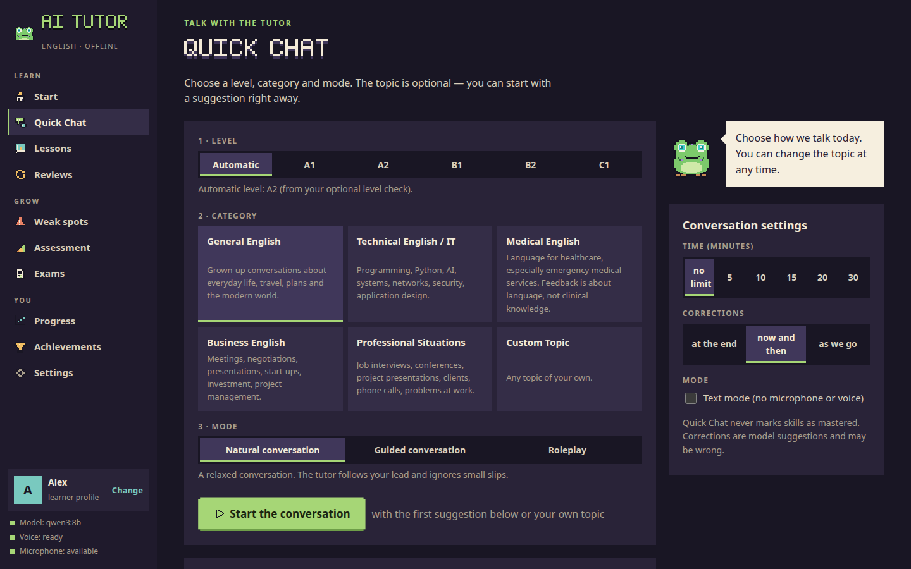
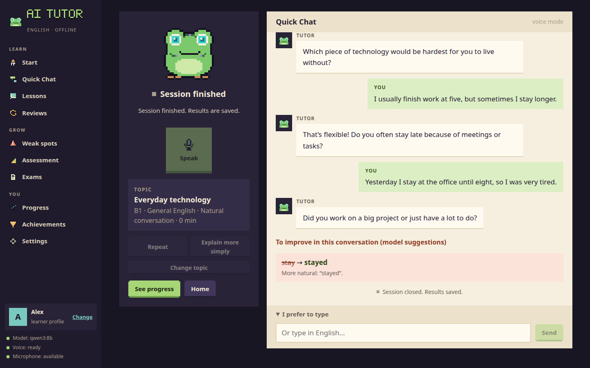
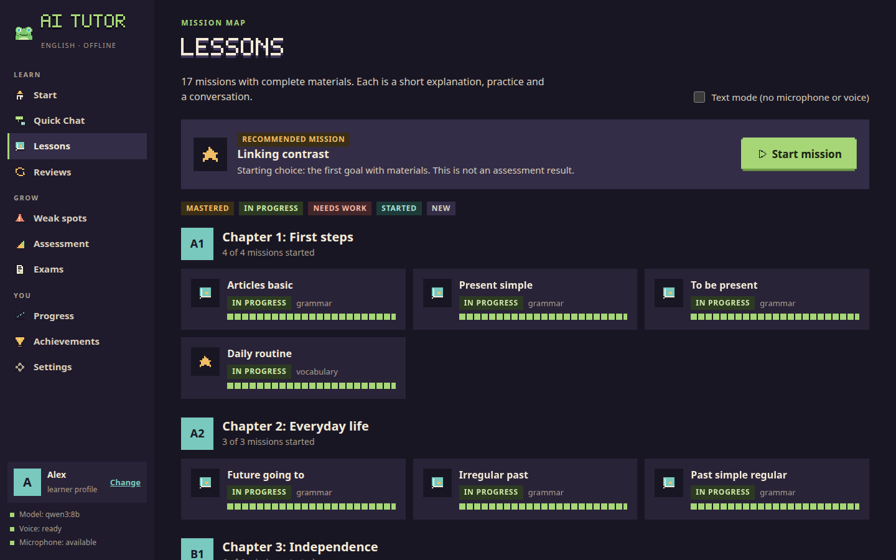
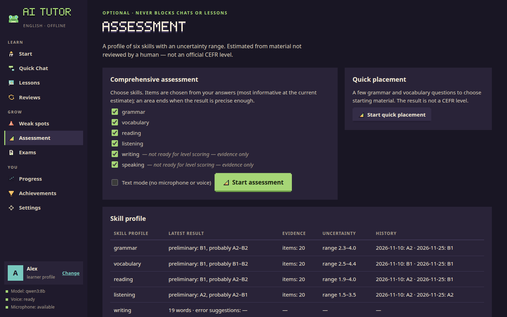
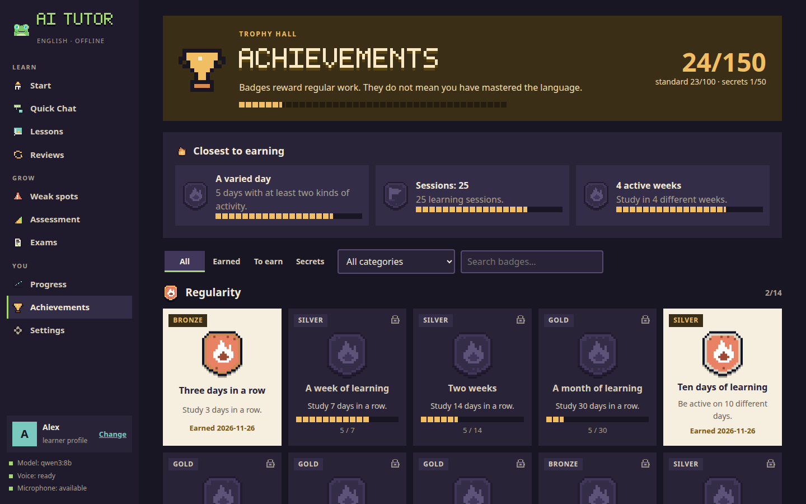
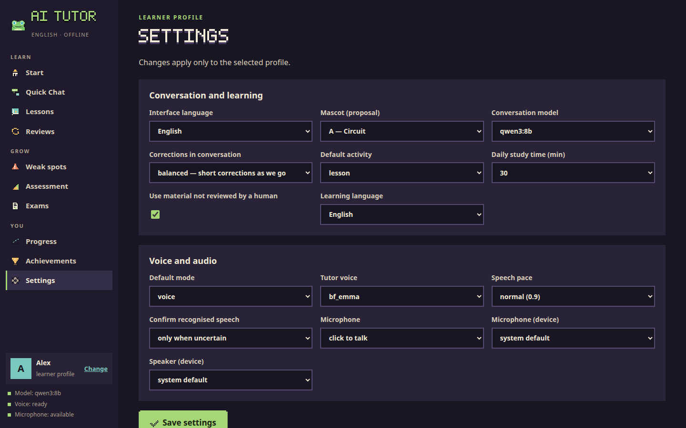
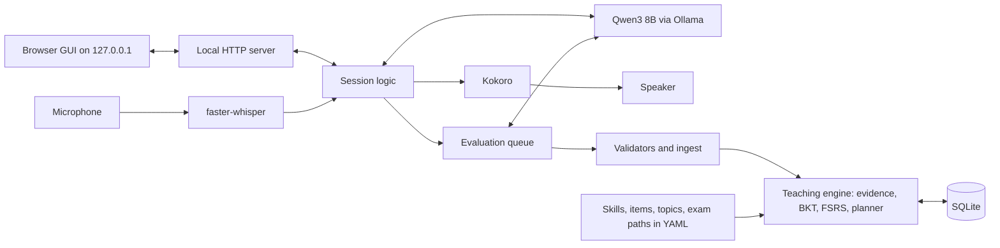

# AI Language Tutor

A local, voice-first English tutor. A local LLM holds the conversation and suggests corrections; a deterministic
teaching engine decides what counts as evidence, what you practise next and when you review it.

Everything runs on your own computer: models through [Ollama](https://ollama.com), speech recognition and speech
synthesis on the CPU, learner data in a local SQLite file. No paid API is needed.


> **Status: research prototype, version 0.1 (development milestone F7).** The browser interface and the command line
> share one engine and are covered by automated tests. The voice path has been tested with simulated and synthetic
> audio, **not yet accepted on a real user's microphone**. Placement and assessment results are provisional
> estimates, **not official CEFR levels**. The project has **no licence yet** (see [Licence](#licence)).

## Contents

- [Features](#features)
- [Screenshots](#screenshots)
- [Models and technology](#models-and-technology)
- [Architecture and data flow](#architecture-and-data-flow)
- [Requirements](#requirements)
- [Installation on Ubuntu](#installation-on-ubuntu)
- [Configuration](#configuration)
- [Optional Gemini API Integration](#optional-gemini-api-integration)
- [Usage](#usage)
- [Assessment, adaptive learning and progress](#assessment-adaptive-learning-and-progress)
- [Achievements](#achievements)
- [Testing](#testing)
- [Repository structure](#repository-structure)
- [Known limitations](#known-limitations)
- [Roadmap](#roadmap)
- [Documentation](#documentation)
- [Licence](#licence)

## Features

| Area | What it does |
|---|---|
| **Quick Chat** | Free conversation at a chosen level (automatic or A1–C1), in one of six categories (General, Technical/IT, Medical with an emergency-services focus, Business, Professional situations, your own topic) and three modes (natural, guided, role-play). 40 topics and 25 role-play scenarios. Commands such as “change the topic”, “repeat”, “explain more simply” and “I want to finish” are recognised in speech or text. |
| **Corrections** | Three policies: at the end, balanced (default) and intensive. Corrections are labelled as model suggestions; you can dispute one or mark it as a speech-recognition error in the weak-spots journal. |
| **Lessons** | Short missions: explanation, closed exercises with hints, then a short conversation that uses the target form. The next lesson is chosen from your recorded evidence. |
| **Assessment** | Optional quick placement and a comprehensive assessment of six skills with an uncertainty range. Writing and speaking are collected as evidence only. |
| **Reviews** | Spaced repetition with FSRS; reviews use items you have not seen first, then the least recently used. |
| **Progress** | Estimates from first, independent attempts on new items, adjusted for difficulty; retention after 3, 7 and 14 days; model error suggestions per 100 words. Trends are shown only with enough data. |
| **Achievements** | 100 standard and 50 hidden badges computed from real records, kept separate from skill mastery. |
| **Exam practice** | One demonstration path (Polish 8th-grade English exam) with section practice and a readiness summary — no points, no score prediction. |
| **Interface** | Local browser GUI in Polish or English, pixel-art design with a frog mascot (three concepts, final choice pending). The command line is in Polish. |
| **Profiles** | Several local learners, per-profile settings, JSON export, progress reset and profile deletion with confirmation and a backup file. |

## Screenshots

All images come from the running application (`python main.py --gui`, English interface) with an isolated
demonstration profile. Conversations were held with the local Qwen3 8B model; exercise and assessment data were
produced by the application's own lesson, review and assessment code with simulated answers.

| | |
|---|---|
|  **Quick Chat setup:** level, category, mode, time and correction policy. |  **Quick Chat:** after the conversation, model suggestions with explanations. |
|  **Medical English role-play:** the tutor stays in the patient's role. |  **Lessons:** mission map by level; the recommendation comes from recorded evidence. |
|  **Assessment:** six-skill profile with ranges, history and evidence counts. |  **Progress:** first-attempt estimates; “not enough data” instead of an invented trend. |
|  **Achievements:** standard and hidden badges, filters and search. |  **Settings:** interface language, mascot concept, models, correction policy, voice and audio devices. |

## Models and technology

| Component | Technology | Role |
|---|---|---|
| Conversation and evaluation | **Qwen3 8B** (`qwen3:8b` in Ollama, thinking off) | Tutor replies; structured observations of errors in learner utterances |
| Optional alternative | **Bielik 11B v2.3 Instruct** (`SpeakLeash/bielik-11b-v2.3-instruct:Q4_K_M`) | Selectable for any role in `config.toml`; used by the legacy `python main.py` text chat |
| Speech to text | **faster-whisper** `small.en`, CPU int8 | Transcription with word confidence (uncertain words are tracked, never counted as learner errors) |
| Text to speech | **Kokoro** (`kokoro-onnx`, int8), default voice `bf_emma` | Tutor voice, three speed presets; exercises are read in parts with pauses |
| Grammar hints (optional, off) | **LanguageTool** 6.6 on localhost | Extra evidence only |
| Scoring, mastery, planning | Own Python code | Rubrics, evidence levels, error taxonomy, Bayesian Knowledge Tracing, planner |
| Spaced repetition | **FSRS** (`fsrs` library) | Review scheduling |
| Storage | **SQLite**, versioned additive migrations | One file per user account; every learner table keyed by profile |
| GUI | Python standard library HTTP server, plain JavaScript | No CDN, no external requests from the page |
| Cloud (off by default) | Gemini via `google-genai` | Optional per-profile model for conversation and/or evaluation, with automatic fallback to local Qwen3 |

Default models per role are defined in `tutor/llm/__init__.py`. Qwen3 8B was chosen over Bielik 11B in a
preliminary benchmark on one machine (130 cases, gold standard not yet reviewed by a human).

## Architecture and data flow



1. You speak or type. Whisper transcribes and marks words it was unsure about.
2. The tutor replies through the LLM, shaped by level, topic, mode and correction policy.
3. Each utterance is evaluated in the background, one at a time. The model only quotes and labels errors; code
   checks every observation (the quote must exist, accepted variants and recognition errors are dropped, a
   correction must change something and must not change the meaning) before it is stored.
4. The engine updates skill state, schedules reviews and plans the next lesson from stored evidence only. Pending
   evaluations survive a restart and are completed later.

Design rules that the tests enforce:

- **The LLM observes, code decides.** No number shown to a learner comes directly from a model.
- **Conversation corrections are suggestions.** Until a measured quality gate is passed (closed today) they never
  change mastery. Lessons, reviews and assessments cannot mark a skill as mastered on their own.
- **Repetition is not progress.** Repeating an item, answers after a hint and uncertain transcriptions are counted
  separately from independent first attempts.
- **Data stays local.** Transcripts are stored; audio is never saved.

## Requirements

**Operating system:** developed and tested on Ubuntu 24.04. Other Linux distributions should work; macOS and Windows
are untested.

**Software:** Python 3.12 or newer (also installed cleanly on 3.13), Ollama 0.9.0 or newer, `libportaudio2` for audio.

**Measured on the author's machine** (Ryzen 7 3700X, 31 GiB RAM, RTX 2060 SUPER 8 GiB, Ollama 0.9.0):

| Item | Measurement |
|---|---|
| Qwen3 8B (Q4_K_M, thinking off) | about 6.0 GiB VRAM, fully on the GPU, about 50 tokens/s |
| Tutor reply, text mode | first token typically 0.6–1.1 s after the model is loaded |
| Evaluation of one utterance | about 0.8–2 s in the background |
| Whisper `small.en` + Kokoro | CPU int8; the app process peaked around 1.2 GiB RAM |
| Disk | `qwen3:8b` 5.2 GB, Kokoro files about 120 MB, Whisper `small.en` downloaded on first use |

Not measured and therefore not promised: CPU-only inference, GPUs with less than 8 GiB, other microphones.
Text mode needs no microphone or speakers.

## Installation on Ubuntu

```bash
# 1. System packages
sudo apt install python3-venv git libportaudio2

# 2. Code and virtual environment
git clone https://github.com/krauzerl/english-ai-tutor.git
cd english-ai-tutor
python3 -m venv .venv
source .venv/bin/activate
pip install -e .                 # core: enough for text mode and the GUI
pip install -e ".[voice]"        # faster-whisper, Kokoro, sounddevice

# 3. Ollama and the model (install Ollama from https://ollama.com first)
ollama pull qwen3:8b
ollama list                      # the server must be running: system service or `ollama serve`

# 4. Kokoro voice files (only for voice)
mkdir -p ~/.local/share/english-ai-tutor/models/kokoro
cd ~/.local/share/english-ai-tutor/models/kokoro
curl -LO https://github.com/thewh1teagle/kokoro-onnx/releases/download/model-files-v1.0/kokoro-v1.0.int8.onnx
curl -LO https://github.com/thewh1teagle/kokoro-onnx/releases/download/model-files-v1.0/voices-v1.0.bin
cd -

# 5. First profile and start
python main.py profile create alice
python main.py --gui
```

The Whisper model (`small.en`) is downloaded by faster-whisper the first time speech recognition starts. Check the
audio devices with `python main.py --voice --list-devices`; `docs/TESTING.md` has read-only Ubuntu audio checks.

Optional extras: `".[dev]"` (tests and linting), `".[browser-tests]"` (Playwright GUI tests), `".[piper]"` (Piper
voice, GPL-3.0), `".[gemini]"` (cloud provider). `pyproject.toml` is the single source of dependencies.

## Configuration

Optional file `~/.config/english-ai-tutor/config.toml` (outside the repository, mode 0600):

```toml
[llm.conversation]
provider = "ollama"
model = "qwen3:8b"
think = false            # omit for models without a thinking mode, such as Bielik

[llm.evaluation]
provider = "ollama"
model = "qwen3:8b"

[llm.ollama]
url = "http://localhost:11434"

[voice]
tts = "kokoro"
tts_voice = "bf_emma"
stt_model = "small.en"

[languagetool]
enabled = false
url = "http://127.0.0.1:8081"    # localhost only; other hosts are rejected
```

Per-profile preferences are changed in the GUI (**Settings**) or with `python main.py --voice --set KEY=VALUE`
(`--set ?` lists the keys): interface language, speech pace, voice, correction policy, text or voice mode,
transcription confirmation, audio devices and the conversation model.

## Optional Gemini API Integration

The tutor runs fully locally by default: **Qwen3 8B in Ollama** for conversation and evaluation, Whisper and Kokoro for
speech. No API key is needed. Gemini is an optional add-on for private experiments.

**Set up (per profile, in the GUI):** Settings → **AI Models**.

1. Paste your own key into **Gemini API Key** and click **Save key**. The field is hidden while you type.
2. Click **Test API**. The app lists the models your key can use for text generation, then sends one fixed test prompt
   (“Reply with the single word OK.”) to the model you picked. A model list alone is not treated as a working
   connection. No learner data is sent by the test, and settings never contact Google on their own.
3. Read the privacy notice and click **I understand and agree**.
4. Tick **Use Gemini in this profile**, then choose the **Conversation model** and the **Evaluation model**
   independently (Local Qwen3 or a Gemini model from the list). Click **Save AI models**.

Each profile has its own key, consent and model choice. A new profile always starts local-only.

**Key storage.** The key goes to the system secret store (Secret Service / GNOME Keyring through the `keyring`
package, installed with `pip install -e ".[gemini]"`). It is filed under a random per-profile identifier, not the
profile name. If no secure store is available, the key is kept in memory for the current run only. It is never written
to SQLite, JSON or `config.toml`, never sent back to the page, and never put into URLs, logs or reports. Only the local
app process uses it. Deleting the key or the profile removes it from the store.

**Automatic fallback.** If Gemini returns HTTP 429, times out, cannot be reached, reports a server error or rejects
the model, the tutor switches once to local Qwen3. You see one notice, and the conversation continues with the same
context. Nothing is generated or saved twice. A short outage pauses Gemini for the time the API asks for (or two
minutes), then the tutor tries once more. A daily quota, an invalid key, an unavailable model, missing consent or the
per-session request limit keep the session local until it ends. For a key or model problem, the notice says that the
key needs fixing. Type `/gemini` during a session to try Gemini again. If neither Gemini nor Ollama answers, the
tutor says so and does not invent a reply. Conversation and evaluation fall back independently.

**Same rules for every model.** Gemini output goes through the same validators as Qwen3: schema check, quote and
category checks, BrE/AmE variants, Whisper uncertainty, Smart Speaking Corrections, disputing a suggestion and the
mastery gates. Invalid JSON is never stored as an evaluation; that utterance is scored once by the local model
instead. Model output is stored as a suggestion, never as a confirmed error.

**What leaves the computer.** Only what the chosen role needs: the transcript of the current utterance and the
recent part of the conversation (the same context Qwen3 gets). Audio, learning history, reports and the database
are not sent. There is no sync with Google.

**Usage control.** One switch turns Gemini off. A per-session request limit applies (default 50, conversation and
evaluation together), with bounded retries. The app shows its own request and token counters. These are local
counters, not your Google quota or bill. Check real limits and any charges in Google AI Studio. The app never
enables billing.

**Logs for comparison.** Each model call writes a `log.llm` learning-log event with no text. It records the role,
the requested and actual provider and model, latency, time to the first token, prompt version, token counts (when
the API reports them), the error reason and whether a fallback happened. See [docs/LEARNING_LOGS.md](docs/LEARNING_LOGS.md).

**Limits and terms.** Gemini needs internet access and is subject to Google's terms and rate limits, which change
over time. From the Gemini API Additional Terms (effective 23 March 2026, checked 27 November 2026):

- You must be 18 or older.
- Apps made available to users in the EEA, Switzerland or the UK may use only Paid Services.
- On the free tier, Google may use submitted content to improve its products, and human reviewers may read it.
  Do not send personal or confidential information.

Free quotas are limited and can run out at any time. A request limit inside the app does not guarantee zero cost on
a paid plan. This repository does not promote the free tier as unlimited.

**Benchmark (optional).** `PYTHONPATH=. .venv/bin/python bench/speaking.py policy --split dev --gemini MODEL
--key-profile NAME --max-requests 60` runs the synthetic correction cases on Gemini. The run uses a hard request cap
and no fallback, and reads the database read-only. No private conversations are used.

## Usage

### Browser interface

```bash
python main.py --gui                          # opens http://127.0.0.1:8765/
python main.py --gui --port 8800 --no-browser
```

The server listens only on `127.0.0.1`. In voice mode, press **Speak** to record and press it again to stop; the
microphone and speakers are used by the Python process, not by the browser. Use **I prefer to type** or the text-mode
switch to type instead. `Ctrl+C` in the terminal stops the server; unfinished lessons, reviews and assessments resume.

### Command line

All commands run from the repository root with the virtual environment active. Add `--no-audio` for text only.
Command-line messages are in Polish.

```bash
python main.py --voice --chat                                   # Quick Chat: choose a topic or type your own
python main.py --voice --chat --chat-level B1 --chat-category medical --chat-mode roleplay
python main.py --voice --lesson                                 # next lesson chosen from your data
python main.py --voice --placement                              # quick placement (grammar, vocabulary)
python main.py --voice --assess grammar,vocabulary,reading      # comprehensive assessment of chosen skills
python main.py --voice --review                                 # spaced-repetition reviews
python main.py --voice --weakspots                              # weak-spots journal; --drill N practises entry N
python main.py --voice --progress                               # also --history, --achievements
python main.py --voice --exam e8_english                        # exam practice path
python main.py --voice --finish-evals                           # finish evaluations left after earlier sessions

python main.py profile list                                     # also create, select, export, reset, delete
python main.py logs report                                      # learning report (Markdown), last 7 days
python main.py logs export                                      # redacted export for later analysis
python main.py content validate en                              # validate the content pack
```

`python main.py` without options starts a minimal legacy text chat with Bielik; `python main.py --help` prints the
entry points.

## Assessment, adaptive learning and progress

- **Quick placement** asks a few grammar and vocabulary questions to choose starting material.
- **Comprehensive assessment** covers grammar, vocabulary, reading and listening with adaptive item selection (the
  most informative item for the current estimate) and stops when the estimate is precise enough. Each skill is
  estimated separately and shown with a range. Writing and speaking tasks collect evidence (length, model error
  suggestions per 100 words) **without a level**, because there is no validated rubric for them yet. Listening needs
  audio, speaking needs a microphone; skills that were not tested are shown as untested.
- **Lessons** are chosen by a deterministic planner from due reviews, recurring errors, skills in progress and the
  next unlocked skill. A lesson never marks a skill as mastered.
- **Reviews** use FSRS. Retention is reported from attempts made at least 3, 7 and 14 days after the previous
  attempt on the same skill.
- **Progress** compares the first and the last 14 days only when both periods have at least 8 independent first
  attempts; otherwise it says “not enough data”. Time spent and badges are explicitly not evidence.

The exercise bank has 115 skills (A1–C1) and 204 items: 161 checked by an AI model, 43 drafts, **none reviewed by a
human yet**. Items, explanations and benchmark cases are labelled with their review status.

## Achievements

150 badges: 100 standard ones in eight categories (regularity, lessons, conversations, reviews, improving weak spots,
challenges, assessment, milestones) and 50 hidden ones. Every badge is a rule over recorded facts — finished
sessions, independent attempts, reviews, assessments, settings changes — and is awarded once per profile. Hidden
badges show only a hint until they are earned. Badges never change skill estimates or mastery; resetting progress
removes them.

## Testing

```bash
pip install -e ".[dev]"
pytest                      # unit, integration and GUI tests with fake models; no Ollama, no audio hardware
ruff check .
python main.py content validate en

pytest -m live              # needs a running Ollama with qwen3:8b (Gemini live tests skip without a key)

pip install -e ".[browser-tests]" && playwright install chromium
pytest tests/test_browser.py              # GUI flows in headless Chromium with a fake model

python -m bench.audit_control --repeat 3  # independent control set for false corrections (needs Ollama)
python -m bench.grammar --system A        # grammar-correction benchmark (needs Ollama)
```

At release: 1,212 tests pass (1 skipped; the 15 live tests are deselected by default), 13 live tests pass with Qwen3
8B, 25 Playwright tests pass, `ruff` reports no issues. There is no CI service; tests are run locally. Results of
live tests and benchmarks vary between runs. Manual acceptance steps, including a real-microphone scenario, and the
measurements are in [docs/TESTING.md](docs/TESTING.md).

## Repository structure

```text
main.py                  entry point: --gui, --voice, profile, content
tutor/
  app/                   sessions, lessons, assessment, reviews, progress, achievements, evaluation queue
  pedagogy/              content model, evidence validation, mastery (BKT), FSRS, planner, diagnosis
  llm/                   Ollama and Gemini providers, structured output, usage budget
  voice/                 audio I/O, faster-whisper, Kokoro, command-line session loop
  gui/                   local HTTP server and static browser interface
  services/              API used by the GUI
  store/                 SQLite access and migrations
  content/               skills, exercise items, explanations, chat catalogue, exam paths (YAML/Markdown)
bench/                   benchmarks and the control set (cases in bench/cases/)
tests/                   pytest suite; tests/live needs Ollama; tests/test_browser.py needs Playwright
tools/                   content extraction and generation helpers
docs/                    testing guide, troubleshooting, screenshots
```

## Known limitations

- **Language suggestions can be wrong.** Qwen3 8B misses roughly a third of errors in the control set and sometimes
  proposes a wrong correction (for example *I have seen him yesterday* → *had seen*). Corrections are shown as
  suggestions and can be disputed; they do not change mastery.
- **Speech recognition.** Whisper `small.en` is reliable on full sentences but weak on single words (*am*, *is*,
  *the*, the letter *B*) and on proper names (*Gdańsk*, *Booking.com*). When the app is unsure it asks you to repeat
  or confirm, and uncertain words are never counted as your errors. The voice path has **not** been accepted on a
  real user's microphone.
- **No validated speaking or writing score.** These skills are collected as evidence only.
- **Not a CEFR certificate.** All levels are provisional estimates from material that no human has reviewed.
- **Single learning language.** English only; command-line messages, explanations and some content descriptions
  are in Polish, so the app is aimed at Polish speakers. The GUI is available in Polish and English.
- **Intensive correction** interrupts only for errors that affect meaning or are lesson goals; minor slips go to
  the end-of-conversation summary.
- **Backups** made before a reset or deletion are JSON exports; there is no restore command yet.
- **Mascot** name and final design are not decided; three concepts can be switched in Settings.

## Roadmap

Planned, in rough order and without dates:

1. Owner acceptance on a real microphone and latency work for voice sessions.
2. Human review of the exercise bank and of the benchmark gold standard.
3. A validated rubric before any speaking or writing level is shown.
4. Choice of the mascot and a restore command for profile backups.
5. More exam paths, more learning languages and an English command line.

## Documentation

- [docs/TESTING.md](docs/TESTING.md) — running the app, automated tests, owner test plans, microphone checks, measurements
- [docs/LEARNING_LOGS.md](docs/LEARNING_LOGS.md) — learning logs: what is recorded, where, reports, export format, privacy
- [docs/TROUBLESHOOTING.md](docs/TROUBLESHOOTING.md) — common problems
- [CHANGELOG.md](CHANGELOG.md) — changes by milestone
- [CONTRIBUTING.md](CONTRIBUTING.md) — setup, checks and content rules
- [SECURITY.md](SECURITY.md) — reporting vulnerabilities
- [THIRD_PARTY_NOTICES.md](THIRD_PARTY_NOTICES.md) and [`tutor/content/en/ATTRIBUTION.md`](tutor/content/en/ATTRIBUTION.md) — sources and licences of teaching material

## Licence

**No licence has been chosen yet.** Until the author decides, all rights are reserved and the code is not licensed
for reuse.

Teaching material adapted from third-party works under CC BY 4.0 and CC BY-SA 4.0 keeps its attribution and change
notices (see [THIRD_PARTY_NOTICES.md](THIRD_PARTY_NOTICES.md)). Models and dependencies are not redistributed and
keep their own licences; the optional Piper voice package is GPL-3.0.
